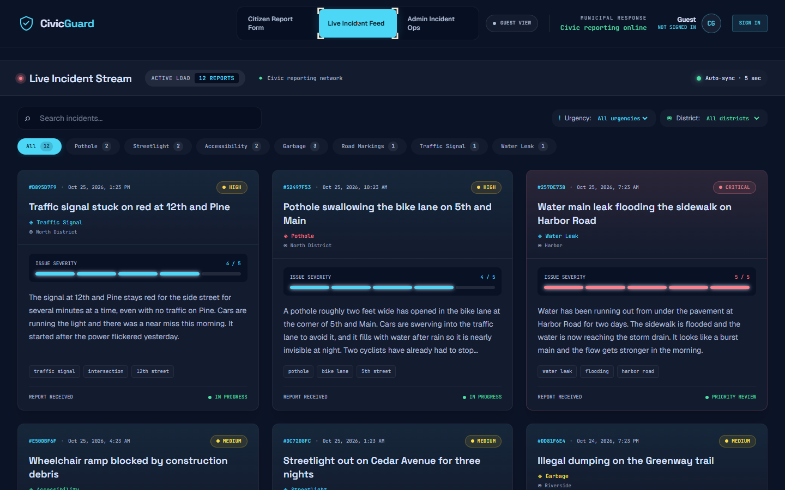

# CivicGuard

**Municipal incident intelligence.** Citizens report potholes, broken streetlights, accessibility blockers and sanitation issues from any device; AI triages each report in the background; authority staff work a live operations dashboard.

Built with React + Vite on the front and Express + SQLite on the back, shipped as **one self-contained service** that hosts both the API and the built UI.



---

## Contents

- [Features](#features)
- [Architecture](#architecture)
- [Tech stack](#tech-stack)
- [Quick start](#quick-start)
- [Production build](#production-build)
- [Deployment](#deployment)
- [Configuration](#configuration)
- [How AI triage works](#how-ai-triage-works)
- [Security model](#security-model)
- [API reference](#api-reference)
- [Project structure](#project-structure)
- [Testing](#testing)
- [Hackathon evidence](#hackathon-evidence)
- [Known limitations](#known-limitations)
- [License](#license)

---

## Features

**Citizen**
- Submit an incident with a title, category, district, description and photo
- Optional location pin: click the map, drag the marker, or use browser geolocation
- No account needed to browse or submit; sign in to be recognised as a citizen
- Anonymous “I see this too” confirmations with one confirmation per device and public tracking codes
- Live feed with a severity-coloured incident map, full-text search, category/urgency/district filters and 5-second auto-sync
- Public City Health page with aggregate-only counts, resolution rates and approximate recent map hotspots
- Email verification flow with invite-gated authority accounts
- Privacy and terms pages, self-hosted fonts, no analytics or third-party trackers

**AI triage**
- Every report is classified into Pothole / Streetlight / Accessibility / Garbage
- Severity score (1–5), urgency level, factual summary, keyword tags, photo quality/category match, and vulnerable-user risk
- Runs **asynchronously** — submission returns in milliseconds, the card updates when triage lands
- Graceful degradation: a timeout or provider outage falls back to keyword-based triage instead of failing the request

**Authority**
- Dashboard with totals, critical counts and resolution rate
- Inline status workflow: Pending → In Progress → Resolved
- Optional resolution notes and after-photos, print-ready work orders, and location-specific QR posters
- Delete incidents (with image cleanup), CSV export hardened against spreadsheet formula injection
- Optional webhook notification for severity-5 reports

---

## Architecture

```
                    ┌──────────────────────────────────────────────┐
  Browser ─────────▶│  Express (single service, port 5000)         │
   (React SPA)      │                                              │
                    │  GET  /                → dist/index.html     │
                    │  GET  /api/reports     → paginated reports   │
                    │  GET  /api/city-health  → public aggregates   │
                    │  POST /api/reports     → save + 201, then    │
                    │                          triage in background│
                    │  PATCH/DELETE /api/reports/:id  (authority)  │
                    │  /api/auth/*           → JWT + verification  │
                    │  /uploads/*            → evidence images     │
                    └───────┬───────────────────────┬──────────────┘
                            │                       │
                   ┌────────▼────────┐      ┌───────▼─────────┐
                   │  SQLite (users, │      │ Gemini API      │
                   │  reports, auth) │      │ (async triage)  │
                   └─────────────────┘      └─────────────────┘
```

The SQLite database and locally stored images live under the configured data directory (`/data` in Docker), which is the only path that needs a persistent volume. Existing `reports.json` data is imported once at startup and left in place as a backup.

## Tech stack

| Layer | Choice |
|---|---|
| UI | React 18, Vite 6, Tailwind CSS 3, Leaflet |
| API | Express 4, Node 20+ |
| Auth | 8-hour JWT in an HttpOnly, Secure, SameSite=Strict cookie; bcrypt (cost 12); hashed, expiring email and password-reset tokens |
| Storage | SQLite (`better-sqlite3`) for users and reports, local disk or S3-compatible object storage for images |
| Maps | Leaflet, marker clustering and heat layer; optional MapTiler light/dark raster tiles with CARTO fallback |
| QR posters | `qrcode` |
| AI | Google Gemini via `@google/genai`, schema-constrained JSON output |
| Ops | Docker, Render blueprint, GitHub Actions, `helmet`, `express-rate-limit` |

---

## Quick start

Requirements: Node.js 20+ and npm.

```bash
npm install
npm --prefix backend install
```

Create `backend/.env` from the template and add at minimum your Gemini key:

```bash
cp backend/.env.example backend/.env
# then edit GEMINI_API_KEY
```

To use MapTiler, set `MAPTILER_API_KEY` in `backend/.env`. This key is sent to browsers for map tile requests, so it is public by design: restrict it in MapTiler to your development/production site referrers and the required map-tile API. If it is unset, maps use CARTO tiles.

Run the API and the Vite dev server in two terminals:

```bash
npm run dev:api    # Express on http://localhost:5000
npm run dev        # Vite on http://localhost:5173 (proxies /api and /uploads)
```

Open <http://localhost:5173>.

> No SMTP configured? Outside production the registration response includes the verification link, so you can activate an account without a mailbox. The link is only returned after the submitted password matches the stored account, and resend also requires the password. Set `RETURN_VERIFICATION_LINK=false` to disable echoing.

### Create an authority account

Authority sign-up requires the invite code from `AUTHORITY_INVITE_CODE`:

```bash
# register with role "authority" and the invite code, then follow the verification link
```

### Load demo data

The feed starts empty. To fill it with a realistic sample set — including
pre-computed triage so no Gemini calls are needed:

```bash
# optional: stop the API before replacing production reports
npm run seed
npm start
```

`npm run seed -- --force` replaces existing reports instead of refusing. The
seed refuses to run while the API is up unless `--force` is supplied. Reports
are written transactionally to the configured SQLite database.

---

## Production build

The Express server serves the compiled SPA, so one process is enough:

```bash
npm run build
npm start          # http://localhost:5000
```

`npm start` serves `dist/` when it exists and falls back to API-only mode otherwise.

---

## Deployment

### Render (recommended, free)

The repository ships a [`render.yaml`](render.yaml) blueprint configured for Render's **Free** plan (no card required):

1. Push the repo to GitHub — `npm run publish`. If the GitHub CLI is installed but not signed in, the script starts the browser sign-in flow, then creates the repo and pushes.
2. Render → **New → Blueprint** → select the repo.
3. Fill in `GEMINI_API_KEY`, `MAPTILER_API_KEY` (optional), and a **new** `AUTHORITY_INVITE_CODE` when prompted.
4. Deploy. Render builds the Docker image, generates `JWT_SECRET`, sets `NODE_ENV=production`, and seeds 12 pre-triaged demo incidents on first boot (`SEED_DEMO_DATA=true`) so the live feed is never blank.

The free instance has 512 MB RAM and sleeps after 15 minutes idle, so the first request after a quiet period takes roughly a minute to wake. `/data` is ephemeral: SQLite, reports and uploads reset on restart/redeploy, and `SEED_DEMO_DATA=true` repopulates the 12 demo incidents on the next boot. That is fine for the hackathon demo. For persistence, switch `plan` to `starter` and add a 1 GB disk mounted at `/data` (paid), or point `REPORT_IMAGE_STORAGE=s3` and the database at hosted services.

Remove `SEED_DEMO_DATA` once the deployment receives real reports. The health check is `GET /api/health`. Because the blueprint provisions no SMTP credentials, it also sets `RETURN_VERIFICATION_LINK=true`: the register dialog hands you the verification link after the password check so accounts work out of the box. Configure SMTP and flip that to `false` for a real deployment.

Render injects `RENDER_EXTERNAL_URL`, so verification links, canonical tags and the sitemap use the real public origin. The app never derives those URLs from the request `Host` header.

### Docker / any container host

```bash
docker build -t civicguard .
docker run -p 5000:5000 \
  -e GEMINI_API_KEY=... \
  -e MAPTILER_API_KEY=... \
  -e JWT_SECRET=... \
  -e AUTHORITY_INVITE_CODE=... \
  -v civicguard-data:/data \
  civicguard
```

Works unchanged on Railway, Fly.io, Azure Container Apps, ECS or a VPS. Mount a volume at `/data` so the SQLite database, reports and uploads survive restarts.

### Split frontend / backend

Deploy the API as above, then build the frontend against it:

```bash
PUBLIC_SITE_URL=https://civicguard.example \
VITE_API_URL=https://api.example.com \
npm run build
```

Serve `dist/` from any static host and add the frontend origin to `CORS_ORIGINS`. Set `FRONTEND_URL` on the API as well so verification emails and the sitemap point at the frontend origin.

### Vercel frontend with a hosted API

`vercel.json` proxies `/api/*` and `/uploads/*` to the Render service and falls back to `/index.html` so client-side routes survive a refresh. The proxy destination is hardcoded to `https://civicguard-o1ik.onrender.com`; update both `destination` values whenever the Render URL changes, or the Vercel deployment will keep calling the old backend. Keeping the API and UI same-origin also keeps the `SameSite=Strict` auth cookie working without cross-site cookie exceptions.

---

## Configuration

All variables are optional except `JWT_SECRET` in production. `GEMINI_API_KEY` enables Gemini triage; without it, reports still submit and use rule-based fallback triage. See [`backend/.env.example`](backend/.env.example) for the annotated list.

`config/city.json` is the shared source for the city name, map center, department routing, severity SLAs, and report categories. The backend falls back to the built-in Bengaluru defaults if this file is absent. Set `ALERT_WEBHOOK_URL` to enable optional JSON `text` notifications for severity-5 triage; leave it empty to disable alerts.

| Variable | Default | Purpose |
|---|---|---|
| `PORT` | `5000` | API port |
| `NODE_ENV` | `development` | Enables production-only safety checks (JWT secret, SMTP, error redaction) |
| `SERVE_STATIC` | `true` | Serve the built SPA from Express |
| `FRONTEND_URL` | `http://localhost:5173` in dev; required in production unless `RENDER_EXTERNAL_URL` is set | Verification-link base URL; also an allowed CORS origin |
| `PUBLIC_SITE_URL` | falls back to `FRONTEND_URL` / `RENDER_EXTERNAL_URL` | Absolute origin for canonical tags and the sitemap |
| `CORS_ORIGINS` | – | Comma-separated additional allowed browser origins; unlisted origins are denied |
| `API_PUBLIC_BASE_URL` | – (relative `/uploads`) | Absolute base for locally stored image URLs |
| `GEMINI_API_KEY` | – | Enables Gemini AI triage; without it, reports still submit and are triaged by keyword rules |
| `MAPTILER_API_KEY` | – | Optional public browser key for MapTiler light/dark map tiles; restrict it by site referrer. CARTO is used when unset |
| `GEMINI_MODEL` | `gemini-3.8-flash` | Model used for triage |
| `ANALYSIS_TIMEOUT_MS` | `180000` | Abandon a stalled triage and flag the report |
| `ALERT_WEBHOOK_URL` | – | Optional Slack/Telegram-style webhook for severity-5 triage alerts |
| `JWT_SECRET` | generated in dev | Must be ≥ 32 characters in production |
| `AUTHORITY_INVITE_CODE` | – | Required for authority self-registration |
| `AUTHORITY_EMAIL_DOMAINS` | – | Optional domain allowlist that bypasses the invite code |
| `RETURN_VERIFICATION_LINK` | `true` outside production | Echo the verification URL when SMTP is unavailable; only after the account password is proved (demo mode) |
| `AUTH_RATE_LIMIT` / `LOGIN_RATE_LIMIT` | `60` / `10` | Auth requests per 15 min per IP |
| `REPORT_RATE_LIMIT` | `5` | Report submissions per 10 min per IP |
| `TRUST_PROXY_HOPS` | `1` in production, else `0` | Reverse-proxy depth for correct client IPs |
| `CIVICGUARD_DB_PATH` | `backend/data/civicguard.db` | SQLite database for users, reports and audit history |
| `CIVICGUARD_REPORTS_PATH` | `backend/reports.json` | One-time source path for importing legacy JSON reports into SQLite |
| `SEED_DEMO_DATA` | `false` | Load 12 pre-triaged incidents when the store is empty (demo deployments) |
| `UPLOAD_DIR` | `backend/uploads` | Local image directory |
| `REPORT_IMAGE_STORAGE` | `local` | `local` or `s3` |
| `SMTP_*` | – | Required in production for verification and password-reset email |
| `S3_*`, `AWS_*` | – | Object storage when `REPORT_IMAGE_STORAGE=s3` |

---

## How AI triage works

1. `POST /api/reports` validates the payload, streams the uploaded image to disk, saves the report in SQLite with `analysisStatus: "pending"` and **responds immediately** (≈20 ms).
2. A background task sends the description and optional photo to Gemini with a JSON schema for category, severity, urgency, summary, tags, photo review, language and vulnerable-user risk.
3. On success the record is patched with the analysis, `analysisStatus: "complete"`, and the AI summary/category replace the provisional ones — unless the citizen typed their own title or category.
4. On timeout (`ANALYSIS_TIMEOUT_MS`) or provider failure, keyword rules provide preliminary triage and the submission itself never fails. When risk to vulnerable users is detected, priority and SLA severity are raised by one level.
5. The feed and dashboard poll every 5 seconds, so cards flip from **ANALYZING** to a graded incident without a refresh.
6. On startup, reports left pending for more than 10 minutes are retried. Submissions with the same category and a location within 50 meters of a report from the last 14 days are linked as duplicates: the API still returns `201`, and the response includes a `duplicate` object with the canonical incident ID and report count.
7. Failed reports can be retried from the feed with the rate-limited `POST /api/reports/:id/triage` endpoint. New submissions appear optimistically while the upload and API request complete.

This replaced a synchronous call that blocked submissions for up to two minutes. With `gemini-3.8-flash`, a triage round trip currently takes roughly 100 seconds; the submission path is unaffected and `ANALYSIS_TIMEOUT_MS` controls when a slow call is abandoned for manual review.

> **Free-tier quota:** the Gemini free tier allows 20 requests per day for this model. Once exhausted, the API returns `429`, the report is flagged for manual review, and the app keeps working. Enable billing on the AI Studio key for an unrestricted demo.

## Security model

- Passwords hashed with bcrypt (cost 12); password length capped at 72 bytes (bcrypt limit).
- JWTs signed with a 32+ character secret and an 8-hour expiry are held in an HttpOnly, Secure, SameSite=Strict cookie, not browser storage. Every authenticated request re-checks that the user still exists, is verified and still holds the claimed role.
- Email verification tokens are random 32-byte values, stored only as SHA-256 hashes, single-use with a 24-hour TTL.
- Password reset uses rate-limited, enumeration-safe requests and single-use SHA-256 token hashes with a 15-minute TTL.
- Authority registration requires the invite code or an explicitly allowlisted email domain — an address ending in `.gov` is **not** sufficient.
- The verification link is only echoed in API responses outside production, or when `RETURN_VERIFICATION_LINK=true` is set deliberately. Echoing requires proof of the account password (re-registering a pending account or calling resend with the password), so knowing an email address alone cannot claim a pending account. If no SMTP is configured and echoing is off, registration fails with a clear `503` instead of creating an account that can never be activated.
- Verification links are built from operator/platform origins (`FRONTEND_URL`, `PUBLIC_SITE_URL`, `RENDER_EXTERNAL_URL`), never the request `Host` header, closing the host-header token-theft path.
- Rate limits on auth (per IP, tighter on login and password-reset requests), report reads, and report submission, which also protects the Gemini quota.
- Image uploads are restricted to a MIME allowlist (JPEG, PNG, WebP), 10 MB max, metadata-stripped and stored under UUID filenames.
- `helmet` sets CSP, HSTS, `X-Frame-Options`, `Permissions-Policy`, `nosniff` and a no-referrer policy. CORS denies browser origins that are not listed; same-origin requests need no configuration.
- CSV export neutralises formula injection (`=`, `+`, `-`, `@`).
- No HTML injection surface: report content is rendered through React, never `dangerouslySetInnerHTML`.
- No analytics, advertising cookies or third-party font CDN. Fonts are self-hosted, auth tokens are not stored in browser storage, and the footer links to accurate privacy and terms pages.

**Deployment checklist**

- [ ] `JWT_SECRET` and `AUTHORITY_INVITE_CODE` set to long random values
- [ ] `NODE_ENV=production`, `RETURN_VERIFICATION_LINK` unset or `false`
- [ ] SMTP configured, or `RETURN_VERIFICATION_LINK=true` left on for a demo (turn it off once SMTP works)
- [ ] `CORS_ORIGINS` set if the API is on a different origin
- [ ] Volume mounted at `/data`
- [ ] `TRUST_PROXY_HOPS` matches your proxy

## API reference

| Method | Route | Auth | Description |
|---|---|---|---|
| `GET` | `/api/health` | – | SQLite and image-storage health (`200` when healthy, `503` with `status: degraded` when either dependency is unavailable) |
| `GET` | `/api/public-config` | – | Public map provider and browser-visible MapTiler key, if configured |
| `GET` | `/api/metrics` | – | Process, HTTP, triage-queue and Gemini metrics; Prometheus text by default, JSON with `Accept: application/json` or `?format=json` |
| `GET` | `/api/city-health` | – | Aggregate city metrics and coarse 30-day map cells; no report IDs or descriptions |
| `GET` | `/api/reports?limit=50&offset=0&assignedTo=USER_ID` | – | Paginated reports as `{ total, limit, offset, data }`; `limit` is capped at 100; `assignedTo=unassigned` selects unassigned incidents |
| `GET` | `/api/reports/:id` | – | Single report with SLA state |
| `POST` | `/api/reports` | – | Submit a report (`multipart/form-data`: `description`, `category`, `customCategory`, `district`, `title`, `latitude`, `longitude`, `image`). Latitude/longitude are optional but must be supplied as a valid pair. Images must be JPEG, PNG or WebP up to 10 MB. Nearby same-category incidents within 14 days return `201` with a `duplicate` link instead of creating a second incident. |
| `GET` | `/api/track/:code` | – | Public tracking lookup by `CG-…` code; returns the linked incident |
| `POST` | `/api/reports/:id/confirm` | – | `{ "deviceHash": "64-hex" }`; adds one “I see this too” confirmation per device and may raise urgency at 5, 10, 20 and 50 confirmations (`409` if already confirmed) |
| `PATCH` | `/api/reports/:id/status` | Authority | `multipart/form-data` or JSON with `status` (`Pending`, `In Progress`, `Resolved`) and optional `note` (300 characters max); an optional `afterPhoto` (JPEG/PNG/WebP) is accepted only when resolving. Every update is recorded in the status audit history. |
| `GET` | `/api/reports/:id/audits` | Authority | Status audit entries with actor, previous/new status, note and timestamp |
| `GET` | `/api/reports/:id/field-audits` | Authority | Triage field-override history for category and severity changes |
| `PATCH` | `/api/reports/:id/triage-review` | Authority | `{ "category?": string, "severityScore?": 1-5 }`; records the override and recomputes SLA routing |
| `POST` | `/api/reports/:id/split` | Authority | Detach a linked duplicate into its own incident |
| `POST` | `/api/reports/:id/merge` | Authority | `{ "targetId": "REPORT_ID" }`; merge this report into another open report of the same category |
| `POST` | `/api/reports/:id/triage` | – | Retry failed AI triage (rate-limited; only reports in the `failed` state) |
| `PATCH` | `/api/reports/:id/assignment` | Authority | `{ "assignedTo": "USER_ID" or null }`; only verified authority members can be assigned |
| `DELETE` | `/api/reports/:id` | Authority | Delete a report and its image |
| `GET` | `/api/admin/reports?limit=100&offset=0&assignedTo=USER_ID&overdue=true` | Authority | Operations report page including duplicates; `limit` is capped at 100; `overdue=true` filters to breached SLAs |
| `GET` | `/api/admin/metrics` | Authority | Resolution rate, average hours to triage/resolve and submissions by category |
| `GET` | `/api/users` | Authority | List user accounts without credential or token data |
| `PATCH` | `/api/users/:id/role` | Authority | `{ "role": "citizen" or "authority" }`; self-demotion and removal of the last verified authority are blocked |
| `DELETE` | `/api/users/:id` | Authority | Delete another user; self-deletion and removal of the last verified authority are blocked |
| `POST` | `/api/auth/register` | – | `{ name, email, password, role, inviteCode? }` |
| `POST` | `/api/auth/login` | – | `{ email, password }` → sets the session cookie |
| `GET` | `/api/auth/session` | – | Current user for a valid session cookie |
| `POST` | `/api/auth/logout` | – | Clear the session cookie |
| `POST` | `/api/auth/verify-email` | – | `{ token }` → verifies the account and sets the session cookie |
| `POST` | `/api/auth/resend-verification` | – | `{ email, password }` → generic message, plus the link in demo mode when the password matches |
| `POST` | `/api/auth/forgot-password` | – | `{ email }` → enumeration-safe reset response |
| `POST` | `/api/auth/reset-password` | – | `{ token, password }` → consume a one-time reset token |
| `GET` | `/api/open311/v2/services.json` | – | Open311 GeoReport v2 service catalog; `/open311/v2/services.json` is an equivalent alias |
| `GET` | `/api/open311/v2/requests.json` | – | Open311 service requests; supports `service_request_id`, `service_code`, `status`, `start_date` and `end_date` filters |
| `POST` | `/api/open311/v2/requests.json` | – | Create a report with `service_code`, `description` and either `lat`/`long` or `address`; uploaded `media_url` is not supported |

## Project structure

```
.
├── backend/
│   ├── CIVICGAURD.json         # required Copilot chat export (43 requests)
│   ├── openapi.yaml            # complete API contract
│   ├── middleware/auth.js      # JWT verification + role guard
│   ├── routes/auth.js          # register / login / verification
│   ├── services/authValidation.js # pure, unit-tested auth helpers
│   ├── services/db.js          # SQLite users, reports, audits and legacy JSON import
│   ├── services/geminiService.js
│   ├── services/imageStorage.js # local disk or S3
│   ├── services/jwtSecret.js
│   ├── services/mailer.js
│   ├── tests/                  # node:test unit suites
│   └── server.js               # API + static SPA + background triage
├── src/
│   ├── components/             # feed, form, dashboard, login, cursor
│   ├── context/AuthContext.jsx
│   ├── services/api.js
│   └── App.jsx
├── e2e/civicguard.spec.js      # Playwright UI suite
├── scripts/smoke.mjs           # end-to-end API checks (CI)
├── scripts/seed.mjs            # demo incident set with pre-computed triage
├── docs/copilot-evidence.md    # export metadata, hash and redactions
├── Dockerfile
├── render.yaml
└── .github/workflows/ci.yml
```

## Testing

```bash
npm run test:unit
npm run test:smoke
npx playwright install chromium
npm run test:e2e
```

The unit suite exercises the extracted authentication helpers directly. The smoke suite boots the API against a throwaway data directory and checks health, auth lifecycle, pagination, duplicate linking, assignment, status and field audit trails, user management, uploads and role guards. The Playwright suite exercises the production UI feed, report submission, authority sign-in, status changes and CSV export. CI runs the production build, unit suite, smoke suite and Playwright suite.

The complete API contract is documented in [`backend/openapi.yaml`](backend/openapi.yaml). Security reports and contribution guidance are in [`SECURITY.md`](SECURITY.md) and [`CONTRIBUTING.md`](CONTRIBUTING.md). Use `npm run publish:sh` with Bash and the GitHub CLI to publish cross-platform; `npm run publish` remains available for PowerShell.

The Open311 GeoReport v2 bridge exposes unauthenticated service catalog and request endpoints at `/open311/v2`. It maps configured CivicGuard categories to `service_code` values and reuses the normal report storage, duplicate linking, SLA routing, rate limits, and background triage. The `/api/open311/v2` prefix is available for deployments that keep all API paths under `/api`.

## Hackathon evidence

The **LEGACY 8.0** hackathon requires the complete GitHub Copilot chat history as a JSON file. The export used to build CivicGuard is committed at [`backend/CIVICGAURD.json`](backend/CIVICGAURD.json) — **43 Copilot requests** from the 24–25 October 2026 build session.

The same conversation is also readable in chat form with no tooling: [`docs/copilot-chat-transcript.md`](docs/copilot-chat-transcript.md) (Markdown) and [`docs/copilot-chat.html`](docs/copilot-chat.html) (chat-style viewer). See [`docs/copilot-evidence.md`](docs/copilot-evidence.md) for the export metadata, SHA-256 integrity hash, verification commands and the three credentials/personal identifiers redacted before publication. No live API keys, tokens, password hashes or production invite codes are in the repository.

## Known limitations

- SQLite report storage is durable and indexed but remains a single-node database; multi-instance writes need a shared server database such as Postgres.
- The public feed and operations dashboard request the newest 100 incidents per refresh. The API exposes `limit` and `offset`, and both UIs disclose when older incidents are not in the loaded page, but neither UI offers full paging yet.
- Email verification is required, so a deployment without SMTP cannot onboard users unless `RETURN_VERIFICATION_LINK` is enabled.
- The incident map loads CARTO tiles by default, or MapTiler tiles when `MAPTILER_API_KEY` is configured. If tiles are blocked, reports remain available as text cards.
- The free Render deployment uses ephemeral storage: the 12 demo incidents reseed, but user accounts, reports and uploads reset on restart/redeploy. Use the Starter disk for persistence.
- AI triage depends on the Gemini free-tier quota (20 reports/day for `gemini-3.8-flash`); exhausted quota degrades gracefully to manual review.

## License

MIT — see [LICENSE](LICENSE).
